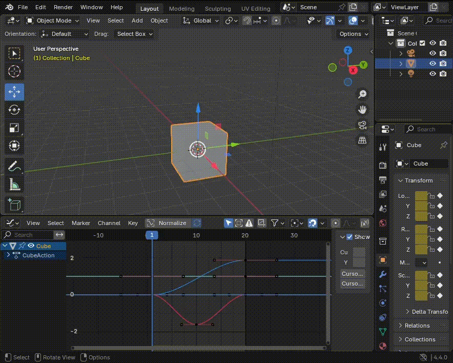

# Animation Auto Offset

This extension adds a new animation editing mode, in which any change you make to a transform or other animatable property gets applied as an offset to the existing keyframes.

This means you can pose a character or object with the normal move/rotate/scale tools and have that adjustment baked into the animation as a relative offset, without manually editing keyframes in the Graph Editor. Change a bone by a few degrees and every affected keyframe moves by the same amount, preserving the original motion.

## Usage

1. Disable Auto Keying (see the note below).
2. Enable **Offset Editing** using the toggle in the Graph Editor or Dope Sheet header.
3. Transform the object or bone as usual. The keyframes are updated as soon as you make the change.

By default every keyframe of the edited property is offset. Enable **Affect only selected keyframes** in the popover menu to restrict the offset to the keyframes currently selected in the Graph Editor or Dope Sheet.

## Easing options

When only a range of keyframes is affected, the offset can end abruptly at the edge of the selection. The **easing window** smooths this transition by blending the offset into a number of neighbouring keyframes before and after the selected range.

In the Offset Editing popover:

- **Window** — how many keyframes on each side of the selection participate in the blend. `0` disables easing and applies the full offset to the selected keyframes only.
- **Asymmetric Window** — enable to set separate **Before** and **After** window sizes instead of a single **Window** value.
- **Adjust Easing Window** (the drag button next to the window value) — move the mouse left/right in the viewport to interactively change the window size. The affected keyframe ranges are highlighted in green in the Graph Editor and Dope Sheet while adjusting. Click the left mouse button to confirm, or press `Esc` / right-click to cancel and restore the previous value. Scroll the mouse wheel to cycle through the available **Curve** options. With **Asymmetric Window** enabled, move to set **Before** and click, then move to set **After** and click again to confirm. Enable **Gradient easing overlay** in the add-on preferences to make the highlight opacity follow the selected easing curve.
- **Curve** — the shape of the blend: Linear, Sine, Quadratic, Cubic, Quartic, Quintic, Exponential, or Circular.
- **Mode** — the easing direction: **In** (slow start, fast end), **Out** (fast start, slow end), or **In & Out** (S-curve).

Easing requires the selected keyframes to be consecutive on every animated channel. If the selection is not sequential, the easing settings are disabled and the full offset is applied to the selected keyframes.

## Auto keying

Offset Editing has no effect while Auto Keying is enabled. To avoid toggling Auto Keying by hand, enable **Auto keying override** in the add-on preferences: turning on Offset Editing will then disable Auto Keying automatically, and turning Auto Keying back on will disable Offset Editing.
