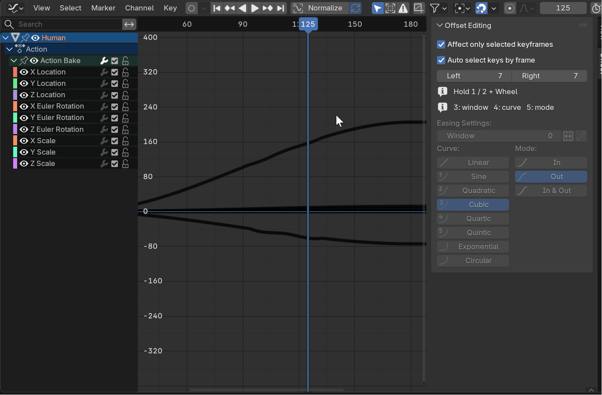

# Animation Auto Offset

This extension adds a new animation editing mode, in which any change you make to a transform or other animatable property gets applied as an offset to the existing keyframes.

This means you can pose a character or object with the normal move/rotate/scale tools and have that adjustment baked into the animation as a relative offset, without manually editing keyframes in the Graph Editor. Change a bone by a few degrees and every affected keyframe moves by the same amount, preserving the original motion.

## Usage

1. Disable Auto Keying (see the note below).
2. Enable **Offset Editing** using the toggle in the Graph Editor, Dope Sheet or Timeline header.
3. Transform the object or bone as usual. The keyframes are updated as soon as you make the change.

By default every keyframe of the edited property is offset. Enable **Affect only selected keyframes** to restrict the offset to the keyframes currently selected in the Graph Editor or Dope Sheet.

**Affect only selected keyframes** and **Auto select keys by frame** are both on by default. When the add-on is enabled it switches Offset Editing on and selects the keyframe at the current frame, so the mode is ready to use immediately.

## Sidebar

The full panel lives in the **Offset** tab of the 3D Viewport-style sidebar (`N`) in the Dope Sheet, Graph Editor and Timeline, so it no longer has to be reached through the header popover. The header popover is still available.

## Auto select keys by frame

Enable **Auto select keys by frame** to select the keyframes around the current frame automatically. Moving the playhead re-selects the keys around the new frame, and the numbers next to the toggle show how many keyframes are selected on each side.

While the option is enabled, hold a number key and scroll the mouse wheel in the Graph Editor or Dope Sheet:

- **1 + wheel** — grow/shrink the selection to the left (towards earlier keys)
- **2 + wheel** — grow/shrink the selection to the right (towards later keys)
- **1 + 2 + wheel** — grow/shrink both sides at the same time
- **Shift** — change the selection by 10 keyframes per wheel step

Wheel up grows the selection, wheel down shrinks it. This works together with *Affect only selected keyframes*, so the offset applies to exactly the range you scrolled to.

## Easing options

When only a range of keyframes is affected, the offset can end abruptly at the edge of the selection. The **easing window** smooths this transition by blending the offset into a number of neighbouring keyframes before and after the selected range.

In the Offset Editing panel:

- **Window** — how many keyframes on each side of the selection participate in the blend. `0` disables easing and applies the full offset to the selected keyframes only.
- **Asymmetric Window** — enable to set separate **Before** and **After** window sizes instead of a single **Window** value.
- **Adjust Easing Window** (the drag button next to the window value) — move the mouse left/right to change the window size. The affected keyframe ranges are highlighted in green in the Graph Editor and Dope Sheet while adjusting. Click the left mouse button to confirm, or press `Esc` / right-click to cancel and restore the previous value. With **Asymmetric Window** enabled, move to set **Before** and click, then move to set **After** and click again to confirm. Enable **Gradient easing overlay** in the add-on preferences for a softer ramp; the curve profile is drawn in either case.
- **Curve** — the shape of the blend: Linear, Sine, Quadratic, Cubic, Quartic, Quintic, Exponential, or Circular.
- **Mode** — the easing direction: **In** (slow start, fast end), **Out** (fast start, slow end), or **In & Out** (S-curve). Linear has no In/Out distinction, so the three modes look and behave the same until a non-linear curve is picked.

The green overlay is shaped by the chosen curve and mode, so switching between In, Out and In & Out changes how the band fades at the edges: *In* stays faint for most of the extension and only darkens next to the selection, *Out* is almost opaque right away, *In & Out* is an S-curve. The flat fill behind it still shows the full extent of the window.

Easing requires the selected keyframes to be consecutive on every animated channel. If the selection is not sequential, the easing settings are disabled and the full offset is applied to the selected keyframes.

## Wheel while transforming (G / R / S)

While **Offset Editing** and **Affect only selected keyframes** are both enabled, moving, rotating or scaling in the 3D Viewport with `G`, `R` or `S` lets you adjust the easing window without interrupting the transform: just scroll the mouse wheel while the transform is running. Wheel up grows the window, wheel down shrinks it, and **Shift** changes it by 10 keyframes. Hold `Ctrl` while scrolling to adjust the **After** window when *Asymmetric Window* is enabled.

The wheel stops changing the proportional-editing size while transforming in this mode. Turn off **Wheel adjusts easing window while transforming** in the add-on preferences to get the default behaviour back.

## Wheel modifiers in the editors

Hold a number key and scroll the mouse wheel in the Graph Editor or Dope Sheet to edit the easing settings without reaching for the panel:

| Hold | Wheel changes |
| --- | --- |
| **3** | Easing window (the green band shows the affected range) |
| **4** | Curve — cycles Linear → Sine → Quadratic → … → Circular |
| **5** | Mode — cycles In → Out → In & Out |

A plain scroll keeps zooming the view as usual. While the **3** key is held the same green band as the drag button is drawn, so you can see the range you are about to affect. With *Asymmetric Window* enabled, hold `Ctrl` while scrolling with **3** to adjust the **After** side.

Turn off **Wheel modifiers in the editors** in the add-on preferences to disable all three.

## Auto keying

Offset Editing has no effect while Auto Keying is enabled. To avoid toggling Auto Keying by hand, enable **Auto keying override** in the add-on preferences: turning on Offset Editing will then disable Auto Keying automatically, and turning Auto Keying back on will disable Offset Editing.

## Preferences

- **Auto keying override** — link Offset Editing and Auto Keying (see above).
- **Gradient easing overlay** — make the green highlight opacity follow the easing curve.
- **Wheel adjusts easing window while transforming** — wheel changes the easing window during `G`/`R`/`S` in the 3D Viewport.
- **Wheel modifiers in the editors** — enable the **3** / **4** / **5** + wheel shortcuts in the Graph Editor and Dope Sheet.

## Installation

Download `anim_auto_offset-1.5.1.zip` and either:

- drag it into Blender, or
- go to **Edit → Preferences → Get Extensions → Install from Disk…** and pick the ZIP.

The ZIP is an extension package, so the legacy **Add-ons → Install…** button does not accept it.

Requires Blender 4.4 or newer.

## License

GPL-3.0-or-later. Originally by [Marek Zajac](https://github.com/marekzajac97/anim-auto-offset).
